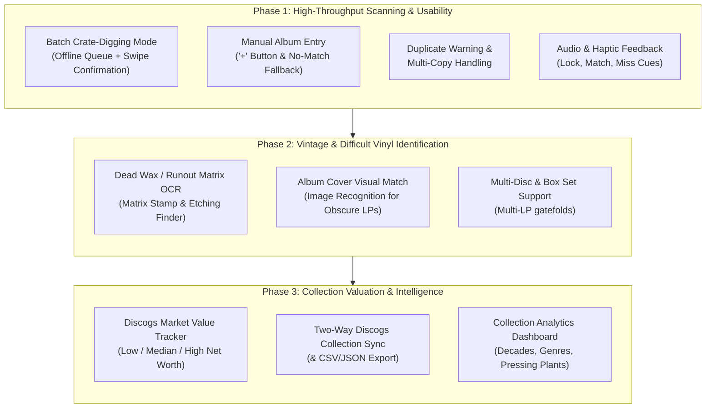

# Vinyl Catalog: Enhancements Roadmap & Backlog

This document tracks all planned, prioritized, and future enhancements for the **Vinyl Record Catalog System** (Android client, FastAPI backend, and PostgreSQL database).

---

## 1. Executive Summary & Priority Matrix

---

## 2. Feature Specifications by Phase

### Phase 1: High-Throughput Scanning & Usability (Immediate Priority)

#### 1.1. Batch "Crate-Digging" Mode
* **Problem**: When cataloging 50–100 records in crates or at record shops, stopping to review each match individually interrupts the physical flow.
* **Solution**:
  - Add a **Batch Mode** toggle on the scanner screen.
  - The camera scans barcodes and center labels in rapid-fire succession, queueing raw identifiers into local SQLite/Room storage.
  - Floating badge displays the live queue counter (e.g., `14 Scanned`).
  - Swiping or tapping the badge takes the user to a **Batch Review Deck** (swipeable card stack) to confirm metadata, assign conditions, and save in bulk.

#### 1.2. Manual LP Entry Workflow
* **Problem**: Rare private pressings, test pressings, local artists, and uncataloged bootlegs do not exist in MusicBrainz or Discogs.
* **Solution**:
  - Two entry points:
    1. **"Create Manual Record"** button directly on the "No Match" prompt.
    2. Persistent **Floating Action Button (`+`)** on the Collection screen.
  - Dedicated **Manual Entry Form**:
    - Snap or pick a cover photo with the phone camera (saved to local media store).
    - Enter Title, Artist, Release Year, Record Label, Catalog Number.
    - Add tracklist rows (Side A / Side B, Track title, Duration).
    - Goldmine condition grades, shelf location, purchase price, and notes.
    - Stored with `metadata_source = 'manual'`.

#### 1.3. Duplicate Warning & Multi-Copy Handling
* **Problem**: Accidentally re-scanning an album already present in the collection creates redundant clutter, but collectors often intentionally own multiple pressings or conditions (e.g., a play copy and a mint shelf copy).
* **Solution**:
  - Before presenting or saving a match, query existing catalog for matching barcode, catalog number, or artist + title.
  - If a match exists, display a non-blocking **Duplicate Alert**:
    - *"You already own a copy of this album (Shelf B, Condition: VG+, Added Aug 2026)"*.
    - Two quick actions:
      1. **"Add as Second Copy"** (distinct condition, shelf location, or notes).
      2. **"Update Existing Copy"** (modify condition/notes of existing record).
      3. **"Skip / Discard"**.

#### 1.4. Audio & Haptic Sensory Feedback
* **Problem**: When aiming the phone at crates or looking down at vinyl sleeves, looking back and forth at the screen to check if a barcode locked slows cataloging.
* **Solution**:
  - Distinct haptic vibration click on instant barcode/label detection.
  - Subtle audio tone on successful match resolution.
  - Distinct double-tap vibration if no match is found.

---

### Phase 2: Vintage & Difficult Vinyl Identification

#### 2.1. Dead Wax / Runout Matrix Etching OCR
* **Problem**: Pre-1970s records lack barcodes and often have generic or damaged labels. The runout groove (dead wax) contains the true matrix numbers and stamper codes (e.g., `RL` for Bob Ludwig, `STERLING`, `VAN GELDER`, `AT/GP`, `PR` for Presswell).
* **Solution**:
  - High-contrast edge enhancement filter optimized for etched and stamped runout text.
  - Auto-extract matrix strings (e.g., `ST-A-691671-A`, `MG-20412-A`).
  - Query Discogs release database specifically on `matrix_runout` fields to pinpoint the exact pressing plant and cutting engineer.

#### 2.2. Album Front Cover Visual Match
* **Problem**: Obscure vintage albums where the barcode is absent and label text is worn or stylized.
* **Solution**:
  - Camera mode allowing snapping the front cover jacket.
  - Visual embedding / reverse image search against Cover Art Archive and Discogs cover art database to identify release candidates.

---

### Phase 3: Collection Valuation, Sync & Analytics

#### 3.1. Discogs Market Value & Pricing Tracker
* **Problem**: Understanding the financial value of the collection and identifying high-value pressings.
* **Solution**:
  - Query Discogs Marketplace API (`/marketplace/price_suggestions/{release_id}`) for specific pressings.
  - Store and display:
    - **Current Market Value**: Low, Median, High.
    - **Collection Net Worth**: Aggregate sum of all median values.
    - **Top Valued Records**: Quick filter to view most valuable items in the collection.

#### 3.2. Two-Way Discogs Collection Sync & Backup
* **Problem**: Keeping the local PostgreSQL catalog synchronized with a Discogs user account, and preventing data lock-in.
* **Solution**:
  - **Discogs Sync**: Push new records directly to your Discogs online collection (`POST /users/{username}/collection/folders/0/releases/{release_id}`).
  - **Export Engine**: Export full personal catalog with tracklists and condition notes to **CSV** and **JSON** for insurance records and offline backups.

#### 3.3. Collection Insights & Analytics Dashboard
* **Problem**: Exploring large collections (1000+ records) by musical and historical dimensions.
* **Solution**:
  - In-app analytics tab with visual charts:
    - **Decade & Year Distribution**: Timeline of collection releases (e.g. 1960s vs 1970s vs 2020s).
    - **Top Labels & Pressing Plants**: e.g., Blue Note, Columbia, Drag City.
    - **Country of Origin**: US, UK, Japan, Germany pressings.
    - **Condition Breakdown**: Distribution of Mint vs VG+ vs VG records.

#### 3.4. Shopping Mode
* **Problem**: When shopping for new vinyl, shopper wants to confirm an potential acquisition is not already in their catalog
* **Solution**:
  -Multiple methods to make it wasy to look up an albim in their existing catalog. Provide methods to use all available scanning methods as well as manual entry of album name, artist and catalog number.
  -Results show all matches with prices paid and year issued
  -This should be implemented after Discogs catalog synch (feature 3.2) so it can use Discogs as the backend 
---

## 3. Implementation Status & Progress Tracker

| Feature | Target Phase | Status | Technical Target |
| :--- | :--- | :--- | :--- |
| **Direct Discogs Barcode Fallback** | Phase 1 | Completed | `backend/app/routers/matcher.py` |
| **Catalog Entry Editing & Pressing Upgrade** | Phase 1 | Completed | `backend/` + `CatalogScreen.kt` |
| **Scanning Pause on Identification** | Phase 1 | Completed | `BarcodeAnalyzer.kt` & `ScannerViewModel.kt` |
| **Vinyl Center Label Mode** | Phase 1 | Completed | `VinylLabelAnalyzer.kt` & `ScanOverlay.kt` |
| **Manual Album Entry ('+' & No-Match)** | Phase 1 | Completed | `ManualAlbumSheet.kt` + `CatalogScreen.kt` + `OcrCorrectionSheet.kt` |
| **Duplicate Warning & Multi-Copy** | Phase 1 | Planned | `backend/` check + Android duplicate dialog |
| **Batch Crate-Digging Queue** | Phase 1 | Planned | Android Room / SQLite queue + batch deck |
| **Audio & Haptic Feedback** | Phase 1 | Planned | Android `Vibrator` & `SoundPool` |
| **Runout Dead Wax Matrix OCR** | Phase 2 | Planned | ML Kit / OpenCV contrast pipeline |
| **Cover Art Visual Match** | Phase 2 | Planned | Image embedding matcher |
| **Discogs Market Value Tracker** | Phase 3 | Planned | Discogs Marketplace API integration |
| **Two-Way Discogs Sync & Export** | Phase 3 | Planned | Discogs Collection API & CSV exporter |
| **Collection Insights Dashboard** | Phase 3 | Planned | Android Jetpack Compose Charts |
| **Shopping Mode** | Phase 3 | Planned | TBD |

## 4. Defects

| Defect | Priority | Status | Notes |
| :--- | :--- | :--- | :--- |
| **Scanner camera stays on while catalog lookup is happening. This wastes battery.** | High | **Resolved** | Dynamically unbinds physical camera sensor (`cameraProvider.unbindAll()`) during lookups, failed scans, and dialogs. Tap anywhere on viewfinder, tap "Scan Again", or dismiss to turn camera back on. |
| **Vinyl label scanner is capturing info and performing a catalog look up before it is centered on the label resulting in frequent, highly erroneous scans** | Critical | **Resolved** | Enforced circular reticle boundary filtering, spindle centroid & vertical spread checks, 650ms stability dwell timer, real-time progress arc, and manual capture shutter button. |

