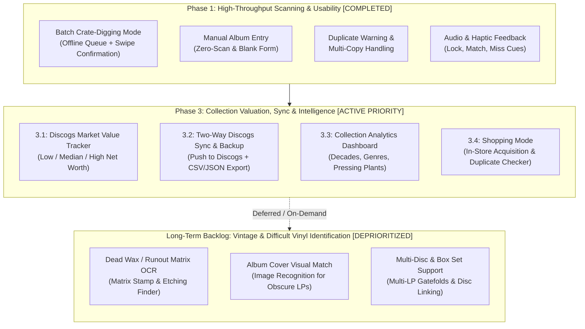

# Vinyl Catalog: Enhancements Roadmap & Backlog

This document tracks all planned, prioritized, and future enhancements for the **Vinyl Record Catalog System** (Android client, FastAPI backend, and PostgreSQL database).

---

## 1. Executive Summary & Priority Matrix

---

## 2. Feature Specifications by Phase

### Phase 1: High-Throughput Scanning & Usability (Completed)

#### 1.1. Batch "Crate-Digging" Mode
* **Status**: Completed
* **Problem**: When cataloging 50–100 records in crates or at record shops, stopping to review each match individually interrupts the physical flow.
* **Solution**:
  - Add a **Batch Mode** toggle on the scanner screen.
  - The camera scans barcodes and center labels in rapid-fire succession, queueing raw identifiers into local SQLite/Room storage.
  - Floating badge displays the live queue counter (e.g., `14 Scanned`).
  - Swiping or tapping the badge takes the user to a **Batch Review Deck** (swipeable card stack) to confirm metadata, assign conditions, and save in bulk.
  - OCR raw inspection, editing, and manual album addition integrated.

#### 1.2. Manual LP Entry Workflow
* **Status**: Completed
* **Problem**: Rare private pressings, test pressings, local artists, and uncataloged bootlegs do not exist in MusicBrainz or Discogs, or the user is in poor lighting and prefers direct entry.
* **Solution**:
  - Three entry points:
    1. Dedicated **"Manual" mode** pill on viewfinder (powers down physical camera sensor to save battery).
    2. Persistent **Floating Action Button (`+`)** on the Collection screen.
    3. **"Create Blank Custom Record"** fallback from the No-Match card or Batch Review deck.
  - Dedicated **Manual Entry Form**:
    - Online metadata search against MusicBrainz & Discogs with one-tap auto-fill.
    - Title, Artist, Release Year, Record Label, Catalog Number, Barcode.
    - Tracklist rows (Side A / Side B, Track title, Duration).
    - Goldmine condition grades, shelf location, purchase price, and personal notes.
    - Stored with `metadata_source = 'manual'`.

#### 1.3. Duplicate Warning & Multi-Copy Handling
* **Status**: Completed
* **Problem**: Accidentally re-scanning an album already present in the collection creates redundant clutter, but collectors often intentionally own multiple pressings or conditions (e.g., a play copy and a mint shelf copy).
* **Solution**:
  - Before presenting or saving a match, query existing catalog for matching barcode, catalog number, or artist + title.
  - If a match exists, display a non-blocking **Duplicate Alert**:
    - *"You already own a copy of this album (Shelf B, Condition: VG+, Added Aug 2026)"*.
    - Quick actions:
      1. **"Add as Second Copy"** (distinct condition, shelf location, or notes).
      2. **"Update Existing Copy"** (modify condition/notes of existing record).
      3. **"Skip / Discard"**.

#### 1.4. Audio & Haptic Sensory Feedback
* **Status**: Completed
* **Problem**: When aiming the phone at crates or looking down at vinyl sleeves, looking back and forth at the screen to check if a barcode locked slows cataloging.
* **Solution**:
  - Distinct haptic vibration click on instant barcode/label detection.
  - Subtle audio tone on successful match resolution.
  - Distinct double-tap vibration if no match is found.
  - Configurable toggle in app Settings.

---

### Phase 3: Collection Valuation, Sync & Intelligence (Active Priority)

#### 3.1. Discogs Market Value & Pricing Tracker
* **Problem**: Understanding the financial value of the collection and identifying high-value pressings requires manual searching on Discogs for each item.
* **Solution**:
  - Query Discogs Marketplace API (`/marketplace/price_suggestions/{release_id}`) for specific pressings.
  - Store and display:
    - **Current Market Value**: Low, Median, High (cached in DB to respect API rate limits).
    - **Collection Net Worth**: Aggregate sum of all median values displayed in the Collection header or analytics screen.
    - **Price Paid vs. Market Value**: Compare purchase price entered during cataloging to current median market price to highlight appreciation / collection value gains.
    - **Top Valued Records**: Quick sorting and filtering to view most valuable items in the collection.

#### 3.2. Two-Way Discogs Collection Sync & Backup / Export Engine
* **Problem**: Keeping the local PostgreSQL catalog synchronized with a Discogs user account, and preventing data lock-in.
* **Solution**:
  - **Discogs Collection Push**: Push new records directly to your Discogs online collection (`POST /users/{username}/collection/folders/0/releases/{release_id}`).
  - **Discogs Collection Import / Pull**: Import existing Discogs collection into the local catalog.
  - **Export Engine**: Export full personal catalog with tracklists and condition notes to **CSV** and **JSON** for insurance records and offline backups.

#### 3.3. Collection Insights & Analytics Dashboard
* **Problem**: Exploring large collections (hundreds or thousands of records) by musical and historical dimensions is difficult through a flat list.
* **Solution**:
  - In-app analytics tab with visual charts:
    - **Decade & Year Distribution**: Timeline of collection releases (e.g. 1960s vs 1970s vs 2020s).
    - **Top Labels & Pressing Plants**: e.g., Blue Note, Columbia, Drag City, Motown.
    - **Country of Origin**: US, UK, Japan, Germany pressings.
    - **Condition Breakdown**: Distribution of Mint vs VG+ vs VG records.
    - **Total Collection Value**: Low / Median / High net worth.

#### 3.4. Shopping Mode
* **Problem**: When shopping for new vinyl in record stores, the collector needs to quickly confirm whether an interesting album is already owned, what pressing is owned, or what was previously paid, without disrupting crate-digging.
* **Solution**:
  - Fast, dedicated **Shopping Mode** in the app:
    - Instant barcode, center label, and text/artist/catalog number search.
    - Immediate ownership status: "Owned (1 copy)", "Owned (Pressing: 1977 US Columbia, VG+, Paid $12.00)", or "Not in Collection".
    - Shows Discogs market price suggestions so user can assess if store price is fair.
    - Seamless one-tap "Mark as Purchased" to stage into catalog with current store price.
  - Builds on Discogs integration and catalog lookup capabilities.

---

### Long-Term Backlog: Vintage & Difficult Vinyl Identification (Deprioritized)

*Note: The following features are deprioritized as per user workflow needs, but all technical specifications and architectural designs are preserved here for future implementation if needed.*

#### 2.1. Dead Wax / Runout Matrix Etching OCR
* **Problem**: Pre-1970s records lack barcodes and often have generic or damaged labels. The runout groove (dead wax) contains the true matrix numbers and stamper codes (e.g., `RL` for Bob Ludwig, `STERLING`, `VAN GELDER`, `AT/GP`, `PR` for Presswell).
* **Solution**:
  - High-contrast edge enhancement filter optimized for etched and stamped runout text.
  - Auto-extract matrix strings (e.g., `ST-A-691671-A`, `MG-20412-A`).
  - Query Discogs release database specifically on `matrix_runout` fields to pinpoint the exact pressing plant and cutting engineer.

#### 2.2. Album Front Cover Visual Match
* **Problem**: Obscure vintage albums where the barcode is absent and label text is worn or stylized.
* **Solution**:
  - Camera mode allowing snapping the front cover jacket.
  - Visual embedding / reverse image search against Cover Art Archive and Discogs cover art database to identify release candidates.

#### 2.3. Multi-Disc & Box Set Support
* **Problem**: Multi-LP gatefolds, 2xLP / 3xLP albums, and box sets have multiple vinyl discs with different matrix numbers/labels under a single release. Current cataloging treats scans individually.
* **Solution**:
  - Support disc count and multi-disc linking (Disc 1 Side A/B, Disc 2 Side C/D).
  - Combined tracklists and consolidated metadata under a single catalog entry.

---

## 3. Implementation Status & Progress Tracker

| Feature | Target Phase | Status | Technical Target |
| :--- | :--- | :--- | :--- |
| **Direct Discogs Barcode Fallback** | Phase 1 | Completed | `backend/app/routers/matcher.py` |
| **Catalog Entry Editing & Pressing Upgrade** | Phase 1 | Completed | `backend/` + `CatalogScreen.kt` |
| **Scanning Pause on Identification** | Phase 1 | Completed | `BarcodeAnalyzer.kt` & `ScannerViewModel.kt` |
| **Vinyl Center Label Mode** | Phase 1 | Completed | `VinylLabelAnalyzer.kt` & `ScanOverlay.kt` |
| **Manual Entry Mode (Zero-Scan & Blank Form)** | Phase 1 | Completed | Dedicated 'Manual' mode pill, camera sensor power-down, online search/autofill, and blank form entry |
| **Batch Crate-Digging Queue** | Phase 1 | Completed | `BatchRepository.kt` + SQLite queue + `BatchReviewDeckSheet.kt` |
| **Audio & Haptic Feedback** | Phase 1 | Completed | `FeedbackManager.kt` & `SettingsScreen.kt` |
| **Discogs Market Value Tracker** | Phase 3 | **Next Up (Active)** | Discogs Marketplace API integration (`/marketplace/price_suggestions/{release_id}`) |
| **Two-Way Discogs Sync & Export** | Phase 3 | Active Phase | Discogs Collection API & CSV/JSON exporter |
| **Collection Insights Dashboard** | Phase 3 | Active Phase | Android Jetpack Compose Charts & Aggregations |
| **Shopping Mode** | Phase 3 | Active Phase | Store acquisition checker with ownership & market price comparison |
| **Runout Dead Wax Matrix OCR** | Long-Term Backlog | Deferred | ML Kit / OpenCV contrast pipeline |
| **Cover Art Visual Match** | Long-Term Backlog | Deferred | Image embedding matcher |
| **Multi-Disc & Box Set Support** | Long-Term Backlog | Deferred | Multi-LP gatefold & disc linking model |

## 4. Defects

| Defect | Priority | Status | Notes |
| :--- | :--- | :--- | :--- |
| **Scanner camera stays on while catalog lookup is happening. This wastes battery.** | High | **Resolved** | Dynamically unbinds physical camera sensor (`cameraProvider.unbindAll()`) during lookups, failed scans, and dialogs. Tap anywhere on viewfinder, tap "Scan Again", or dismiss to turn camera back on. |
| **Vinyl label scanner is capturing info and performing a catalog look up before it is centered on the label resulting in frequent, highly erroneous scans** | Critical | **Resolved** | Enforced circular reticle boundary filtering, spindle centroid & vertical spread checks, 650ms stability dwell timer, real-time progress arc, and manual capture shutter button. |
| **When a catalog search yields one result, when you try to refine it, it says there are no alternate versions and it gets marked as unspecific** | High | **Resolved** | Single-match scans automatically mark the pressing as 'specific', display a 'SPECIFIC PRESSING' badge, and suppress the 'Refine Pressing' button. Refinement fallback with 0 alternate variants also preserves 'specific' pressing status. |
| **Batch mode scanning too fast / duplicates, no OCR inspection/correction on unmatched items, and missing manual add** | High | **Resolved** | Implemented 20s duplicate debounce cooldown, queue deduplication checks, captured OCR display with collapsible raw text, 'Correct OCR' & 'Search Release' dialogs for uncataloged/misread items, and '+ Add Manual' button in the Batch Review Deck. |
| **Virtual keyboard obscures Backend URL field during editing** | Medium | **Resolved** | Added `Modifier.imePadding()` to the scrollable Settings container, attached `BringIntoViewRequester` with smooth focus relocation, added URI keyboard options with Done action, and added quick presets for Server LAN, Tailscale, and Emulator. |

